<p align="center"></p>

<p align="center">
  
  
  
  
  
  
  
  
</p>

<p align="center">
  
</p>

<p align="center">
  <b>A glass-box, bias-aware AI recruiting agent.</b><br>
  Paste a job description and resumes → get an <b>evidence-cited</b> ranked shortlist, tailored interview kits,
  natural-language Q&amp;A over the candidate pool, and a <b>Blind Mode</b> that shows whether name or school
  signals are moving your ranking — with a human in the loop the whole way.
</p>

<p align="center"><i>Built for the AI Agent Hackathon 2026 · Problem Statement 3</i></p>

<p align="center">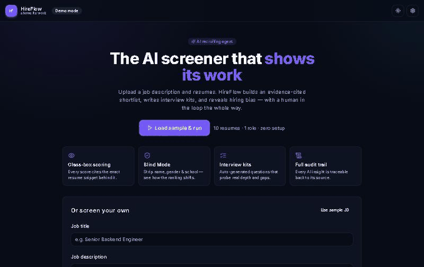</p>

---

## 💡 What it is

Most AI screeners are black boxes: a number comes out and nobody can say why. HireFlow is built on one rule —
**every machine judgment must be auditable.** Each score is broken into four weighted dimensions, each dimension
quotes the exact resume line it relied on, and every agent step lands in an audit trail.

It runs **entirely in the browser with zero setup** (a local TypeScript engine). You can optionally switch to a
**Python scikit-learn backend** or **live Claude** in Settings, and turn on **Supabase** to keep screenings across
reloads — each browser gets its own private workspace.

## ✨ Features

| | Feature | What you get |
|---|---|---|
| 🔍 | **Glass-box scoring** | 4 weighted dimensions (skills 35%, experience 25%, domain 20%, seniority 20%), each with quoted resume evidence |
| 🛡️ | **Blind Mode** | Strips name, gendered words, age/graduation years and prestige schools, re-scores, and shows who moved and by how much |
| 🗂️ | **Ranked or grouped shortlist** | Strong fit (≥ 75) · Potential (55–74) · Not a fit (< 55), plus "info to validate" flags and gaps |
| 🎯 | **Interview kits** | Questions that probe the candidate's real depth and known gaps, with follow-ups — exportable as PDF |
| ⚖️ | **Side-by-side compare** | Up to 3 candidates, best score per dimension highlighted |
| 💬 | **Ask the pool** | Natural-language questions across all resumes, answered with cited snippets |
| 📋 | **Interview evaluation** | Paste notes → requirement coverage (met / partial / not met), still-unproven areas, follow-up questions, PDF report |
| 🧠 | **Live agent trace** | Watch JD Analyzer → Resume Extractor → Matcher/Scorer → Kit Generator → Pool Q&A → Evaluator run |
| 🧾 | **Audit trail** | Every insight records its inputs and the engine that produced it |
| ☁️ | **Private cloud save** | Optional Supabase persistence, row-level-secured per user |
| 🌗 | **Dark / light, mobile-ready** | Theme toggle, phone navigation bar |

## 📸 Screenshots

All screenshots use the built-in **fictional** sample pool (one role, ten made-up candidates).

| Shortlist | Blind Mode |
|---|---|
| 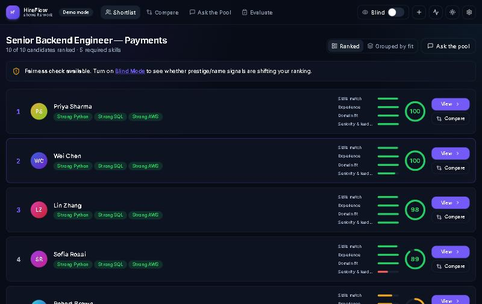 | 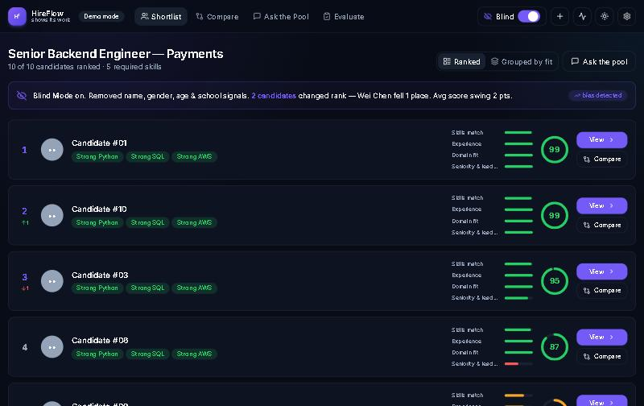 |
| **Evidence behind every score** | **Tailored interview kit** |
| 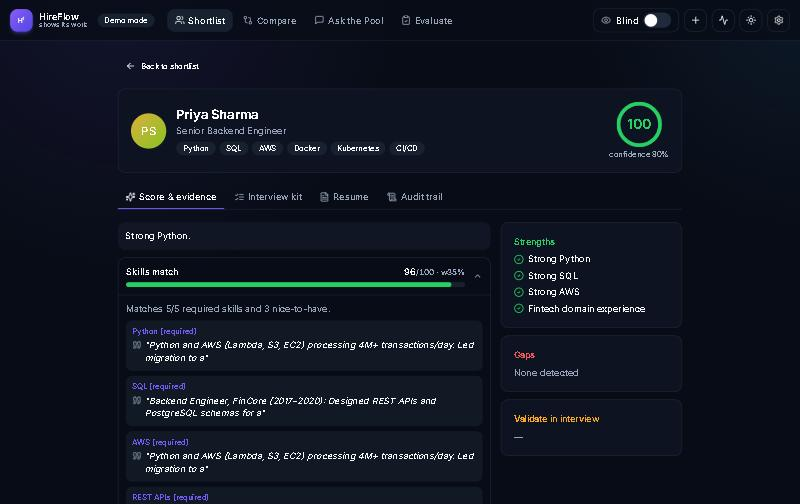 | 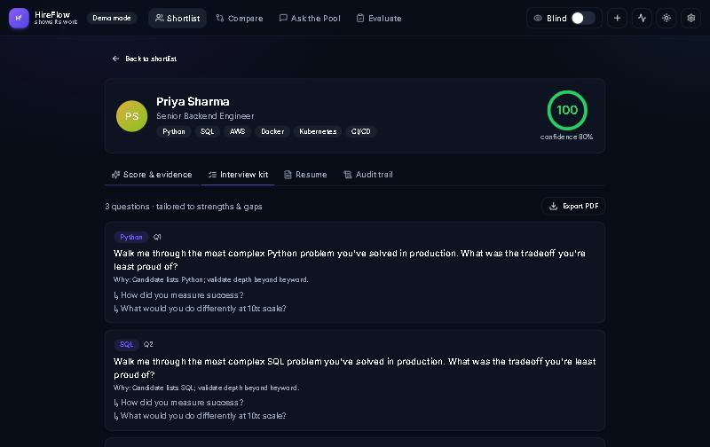 |
| **Compare candidates** | **Ask the pool** |
| 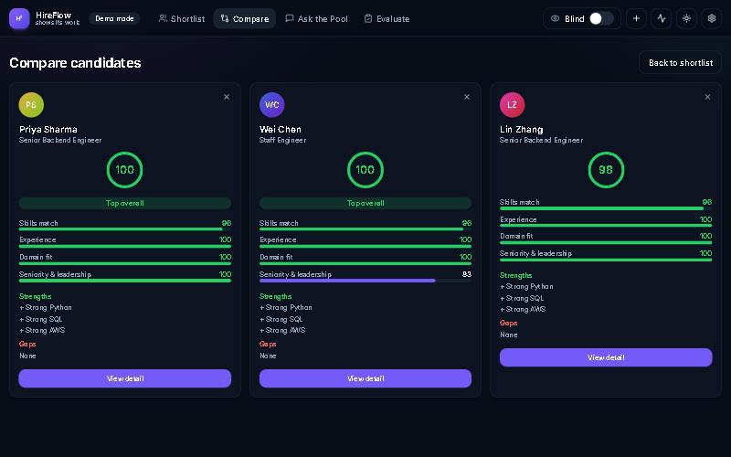 | 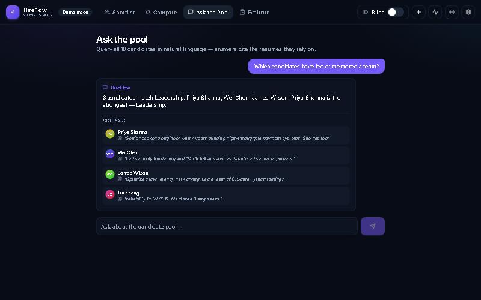 |
| **Interview evaluation** | **Agent trace & audit log** |
| 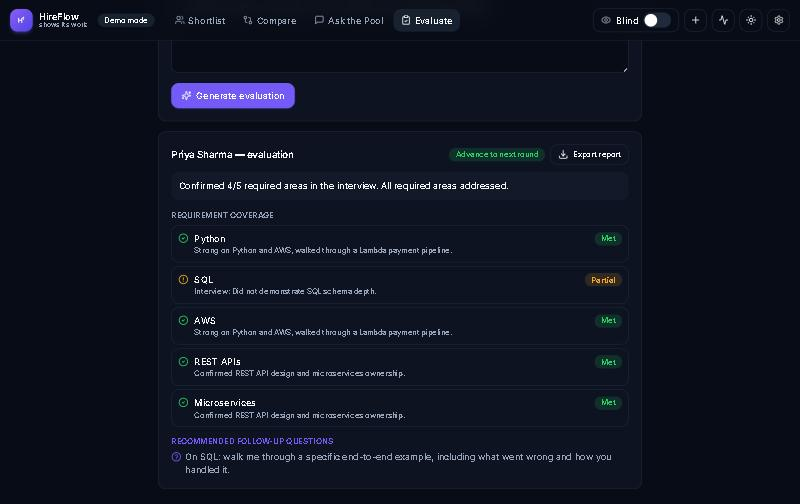 | 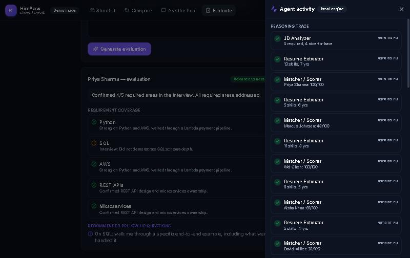 |

<details>
<summary>Landing page, live screening and phone layout</summary>

| Landing | Agents working | Phone |
|---|---|---|
| 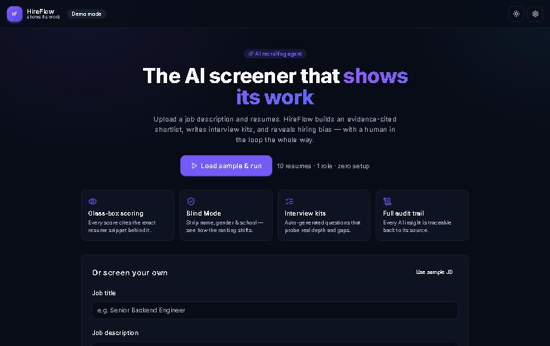 | 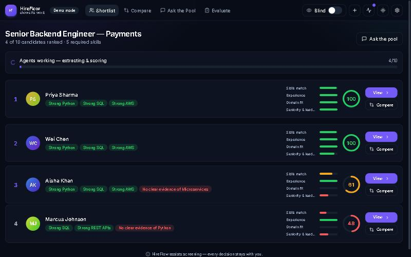 | 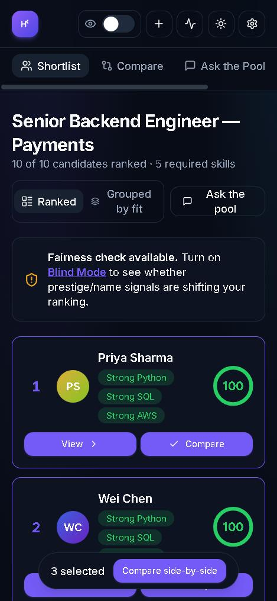 |

</details>

## 🧩 How it works

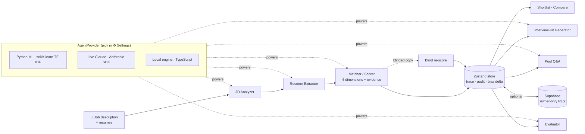

Three interchangeable engines sit behind one `AgentProvider` interface. Priority is **Python ML → Live Claude →
local engine**; if the chosen engine fails (bad key, backend down), that step falls back to the local engine and the
app shows a banner saying so.

| Engine | Where | How it works |
|---|---|---|
| **Local** (default) | `src/lib/agent/demo.ts` | TypeScript heuristics: skill-alias matching, section-aware JD parsing, cited snippets. No network. |
| **Python ML** | `api/` (Flask → Vercel serverless) | scikit-learn TF-IDF (1–2 grams) + cosine similarity; best-matching resume sentence becomes the evidence. |
| **Live Claude** | `src/lib/agent/claude.ts` | Anthropic SDK with JSON-only prompts (`src/lib/agent/prompts.ts`); Opus / Sonnet / Haiku 5.5 selectable. |

## 🚀 Quickstart

```bash
git clone https://github.com/ekupekuAI/Hireflow.git
cd Hireflow
npm install
npm run dev
```

Open the printed URL and click **Load sample & run** — no keys needed.

**Optional — Python ML engine**

```bash
pip install -r api/requirements.txt
python api/index.py          # http://localhost:8077  (set PORT to change)
```

Then ⚙️ **Settings → Python ML engine → on**. On Vercel it deploys automatically as a serverless function at `/api`.

**Optional — Live Claude:** ⚙️ **Settings → Live AI**, paste your Anthropic key, pick a model. The key stays in
that browser's localStorage and is sent only to `api.anthropic.com`.

**Optional — Cloud save (Supabase)**

1. Supabase → **SQL Editor** → run [`supabase/schema.sql`](supabase/schema.sql) (safe to re-run; it upgrades older public tables).
2. **Authentication → Sign In / Providers → Allow anonymous sign-ins.**
3. `cp .env.example .env` and fill in the two variables below, then restart `npm run dev`.

**Build / deploy:** `npm run build` → `dist/`. On Vercel, importing the repo deploys both the Vite app and the
Python function (see `vercel.json`); set the env vars in Project → Settings → Environment Variables.

## 🔑 Environment variables

All optional — without any of them HireFlow runs fully on its local engine.

| Name | Required? | Where to get it |
|---|---|---|
| `VITE_SUPABASE_URL` | Only for cloud save | Supabase → Project Settings → API → **Project URL** |
| `VITE_SUPABASE_ANON_KEY` | Only for cloud save | Supabase → Project Settings → API → **anon / publishable key** (browser-safe; RLS protects rows) |
| `VITE_ML_API_URL` | No | Override the ML backend URL (defaults: `http://localhost:8077` in dev, `/api` in production) |

The Anthropic API key is intentionally **not** an env var: anything prefixed `VITE_` is baked into the public
bundle. Each user enters their own key in Settings ([console.anthropic.com](https://console.anthropic.com)).

<details>
<summary>📁 Project structure</summary>

```
Hireflow/
├── api/                      # Python ML engine (Flask; Vercel serverless function)
│   ├── index.py              #   routes: /health /analyze-job /extract /score /interview-kit /ask-pool /evaluate
│   ├── ml.py                 #   TF-IDF + cosine similarity matcher
│   └── requirements.txt
├── docs/readme/              # README banner, screenshots, walkthrough GIF
├── public/favicon.svg
├── src/
│   ├── App.tsx               # view switch + error banner
│   ├── components/           # Layout, SetupScreen, Dashboard, CandidateCard, CandidateDetail,
│   │                         # Compare, AskThePool, Evaluate, AgentTrace, SettingsDialog, ui
│   ├── data/sampleData.ts    # fictional sample role + 10 candidates
│   └── lib/
│       ├── agent/            # AgentProvider: demo.ts (local), mlProvider.ts, claude.ts, prompts.ts, fallback.ts
│       ├── blind.ts          # redaction for Blind Mode
│       ├── skills.ts         # skill / domain alias dictionaries
│       ├── store.ts          # Zustand store: pipeline orchestration, trace, audit, bias delta
│       └── supabase.ts       # anonymous auth + owner-scoped persistence
├── supabase/schema.sql       # screenings table + owner-only RLS policies
├── .env.example
└── vercel.json
```

</details>

## 🆕 What's new in this version

| Area | Before | After |
|---|---|---|
| 🔐 Data isolation | Saved screenings (candidate PII) were readable **and deletable by anyone** holding the public anon key | Rows owned per user (`owner_id = auth.uid()`), owner-only RLS, anonymous sign-in per browser |
| 🛡️ Blind Mode | Detail, Compare, Evaluate and Pool views still showed real names, raw resumes and non-blind scores | Every view stays blinded; the pool engine only sees redacted resumes |
| 🧾 JD parsing | With "About the role" before "Required", nice-to-haves came out **empty** | Sections split in document order — sample JD now yields 5 required + 4 nice-to-have |
| 📋 Evaluation | "Did **not** demonstrate SQL" was marked *Met*; "go" matched "good" | Sentence-level negation + whole-word matching |
| ⚠️ Errors | Errors were stored but never shown; Live/ML fallbacks were silent (bad key = no feedback) | Dismissible banner for errors and engine fallbacks; no stuck spinners |
| 🧭 Navigation | No way back to start a new screening; no nav on phones; header and cards overflowed at 375 px | New-screening button, mobile nav bar, cards and header fit phone widths |
| ☁️ Cloud sync | Kits and evaluations made after saving were lost on reload | Synced to the saved screening |
| 🔧 Misc | Outdated Claude model IDs; `ml.py` import could fail on Vercel; malformed API input → 500 | Current model IDs (old settings migrated); robust import; 400 on bad input; unused `VITE_ANTHROPIC_API_KEY` removed |

## 🔭 Future development

- Real recruiter accounts (email / SSO) instead of anonymous sign-in, so a workspace follows the user across devices.
- Move the Claude key server-side (Supabase Edge Function or the existing `api/` function) for public deployments.
- PDF / DOCX resume parsing (today: paste text or upload `.txt` / `.md`).
- Sentence-transformer embeddings in `api/ml.py` (same interface; needs a host without Vercel's size limit).

## ⚖️ Responsible use

HireFlow **assists** screening; it does not decide. Blind Mode, confidence flags, "info to validate" and the audit
trail exist to keep a human accountable for every hiring decision.

## 📄 License

MIT — built for a hackathon, free to learn from.
